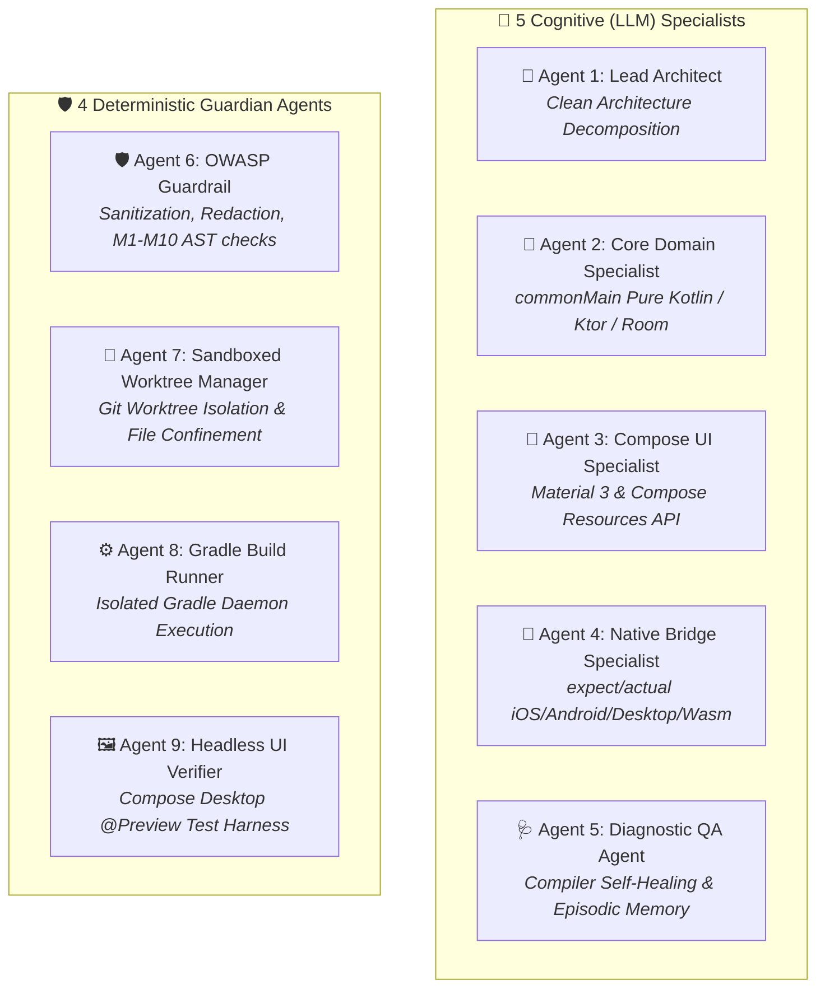
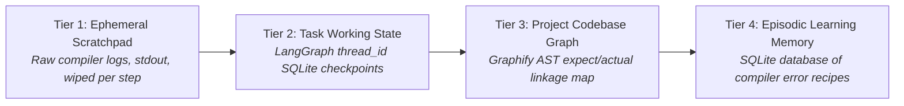
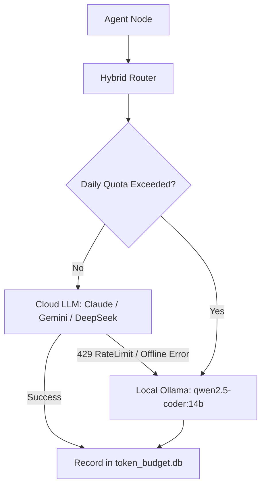

# 🏛️ Architecture & System Specification

## 1. System Philosophy & Objectives
The **KMP Agentic System** is an autonomous, hybrid multi-agent engineering platform designed specifically for **Kotlin Multiplatform (KMP)** and **Compose Multiplatform** development. It combines the reasoning strengths of top-tier cloud models with the data privacy and zero cost of local offline LLMs.

---

## 2. The 9-Agent Hybrid Roster

---

## 3. 4-Tier Cognitive Memory Hierarchy

1. **Tier 1 (Ephemeral Scratchpad)**: Raw compiler logs, stdout, and tool outputs stored in memory during node execution.
2. **Tier 2 (Task Working State)**: Stateful checkpoints in SQLite (`.sessions/checkpoints.db`) indexed by `thread_id`. Supports time-travel rewinds and session forking.
3. **Tier 3 (Project Codebase Graph)**: AST knowledge graph powered by **Graphify (`Graphify-Labs/graphify`)** mapping `expect` contracts to platform `actual` source files.
4. **Tier 4 (Episodic Learning Memory)**: Evolutionary SQLite knowledge base of resolved compiler errors, root causes, and verified fix recipes.

---

## 4. Hybrid Cloud-Local Model Gateway

- **Cloud Primary**: Supports **Anthropic Claude 3.5 Sonnet**, **Google Gemini 2.0 / 1.5**, and **DeepSeek V3 / R1**.
- **Local Fallback**: Zero-downtime automatic fallback to **Ollama (`qwen2.5-coder:14b`)**.
- **Ledger Tracking**: Tracks daily token burn and estimated cost in SQLite (`token_budget.db`).
